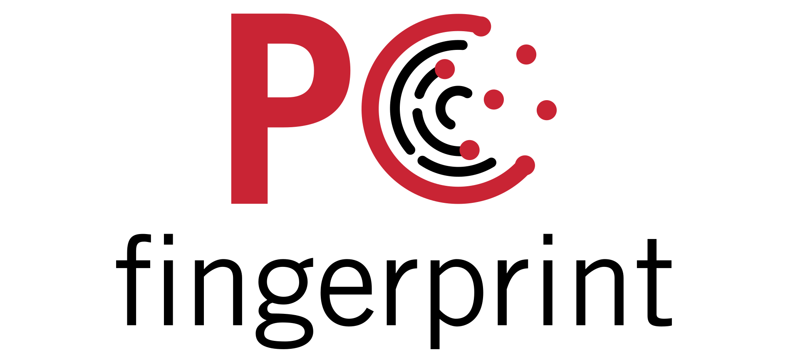

# pcfingerprint

`pcfingerprint` is a Python package for fitness-forpurpose and realism assessment of simulated laser scanning point clouds.


## 💻 Installation

### Prerequisites

`pcfingerprint` requires Python >= 3.9 and < 3.14.
We recommend using a virtual environment to manage dependencies, e.g., `conda`/`mamba`:

```bash
mamba create -n pcfingerprint python=3.13
```

### Building from source using pip

The following sequence of commands is used to install `pcfingerprint` from source using pip. It is recommended to do this in a virtual environment.

```bash
git clone https://github.com/3dgeo-heidelberg/pcfingerprint.git
cd pcfingerprint
python -m pip install -v --editable .
```

The `--editable` flag allows you to change the Python sources of `pcfingerprint` without
reinstalling the package. The `-v` flag enables verbose output which gives you
detailed information about the compilation process that you should include into
potential bug reports.

## 💟 Funding / Acknowledgements

`pcfingerprint` is developed by the [3DGeo Research Group](https://www.uni-heidelberg.de/3dgeo) together with the [Scientific Software Center (SSC)](https://www.ssc.uni-heidelberg.de/en) at Heidelberg University. It is funded by the [Deutsche Forschungsgemeinschaft (DFG)](https://www.dfg.de/de) in the frame of the [Sustainable HELIOS](https://www.geog.uni-heidelberg.de/en/3dgeo/projects-of-the-3dgeo-research-group/fostering-a-community-driven-and-sustainable-helios-scientific-software) project and closely connected to [HELIOS++](https://github.com/3dgeo-heidelberg/helios).


## 📜 License

See [LICENSE.md](LICENSE.md)
